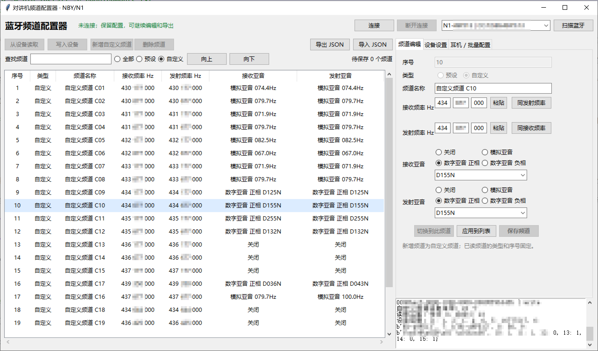
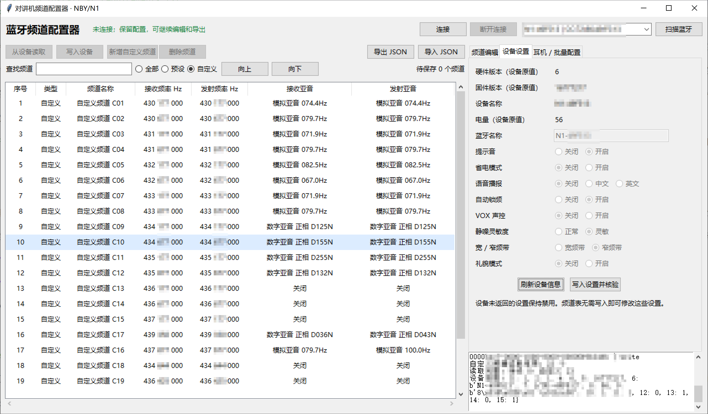

# 努比亚 N1 蓝牙频道配置器

使用 Python 和 Tkinter，通过蓝牙连接努比亚 N1 对讲机，读取、编辑和保存频道及设备设置。程序入口为 `radio_configurator.py`。

## 界面预览

频道编辑：



设备设置：



## 安装与运行

建议使用 Windows、Python 3.10 或更新版本，并确保电脑蓝牙可用。标准 Windows Python 自带 Tkinter；蓝牙依赖通过 requirements 安装。

在项目根目录运行：

```powershell
python -m venv .venv
.\.venv\Scripts\python.exe -m pip install -r requirements.txt
.\.venv\Scripts\python.exe radio_configurator.py
```

已有 `.venv` 时跳过创建环境。启动时频道列表为空，不会自动扫描或连接。

## 连接与读取

1. 打开对讲机，让它处于蓝牙可连接状态，断开手机 APP 或其他程序的连接。
2. 首次点击“扫描蓝牙”。列表只显示名称以 `N1` 开头的设备，结果自动保存。
3. 选择设备并点击“连接”。下次启动可以直接连接记录的设备，无需重新扫描。
4. 连接后自动读取频道、当前频道和设备信息，频道逐条显示。

“全部 / 预设 / 自定义”决定读取与整表保存的类型范围，下次启动保留选择。“查找频道”只筛选显示，不缩小写入范围。

连接按钮显示“已连接”后，可点击“断开连接”。断开保留当前会话中的频道列表、设备设置和编辑内容，可离线编辑、导出；重新启动不会恢复未保存的频道编辑。

## 频道编辑与保存

选中一行，在右侧“频道编辑”页修改配置。当前频道用红色文字标记。双击一行或点击“切换到此频道”可切换，程序读取设备状态确认结果。

| 操作 | 行为 |
|---|---|
| 应用到列表 | 修改本地列表，稍后保存 |
| 保存频道 | 立即保存选中频道并读回核验，保留其他待保存修改 |
| 写入设备 | 保存当前类型范围内已完整读取的修改，并读回核验；同时应用范围内当前编辑框的内容 |
| 新增自定义频道 | 填写后点击“新增并保存到设备”，立即新增并核验 |
| 删除频道 | 确认后立即删除自定义频道并核验，无需再点击“写入设备” |
| 复制选中频道 | 将选中配置复制为新的自定义频道，立即新增到设备并核验 |
| 撤销本地修改 | 恢复最后成功读取或保存的快照，取消未提交编辑及排序 |

修改过的频道显示 `*`，并显示“待保存 N 个频道”。单频道保存成功只清除自身标记；没有修改时保存按钮置灰。鼠标悬停在灰色操作按钮上可查看原因。

### 预设频道限制

预设频道仅可修改收发亚音。名称、收发频率、编号、类型不可编辑，不能新增或删除预设；导入和写入也执行这些限制。已读自定义频道的编号、类型同样固定，排序使用“向上 / 向下”。

### 频率和亚音

- 频率按 Hz 分成三段，如 `430 | 137 | 500`；列表显示 `430 137 500`。
- 输入数字覆盖光标后的一位，完成第三位后跳到下一段；接收最后一段完成后跳到发射第一段。
- 段首退格或左方向键返回上一段，段尾右方向键进入下一段。
- “粘贴”或 Ctrl+V 支持 `430137500`、`430 137 500`、`430.137500 MHz`。非法格式保持原内容，不完整时显示提示。
- “同发射频率 / 同接收频率”复制整组频率；预设频率的输入、粘贴和复制均禁用。
- 亚音先选择关闭、模拟、数字正相或数字负相，再从对应列表选择。选中已读频道时自动回填。

### 自定义排序

“向上 / 向下”交换相邻编号的完整配置，选中行和当前频道红色标记跟随配置移动，设备暂不切换。

例如自定义 5 上移到 4，原当前频道 4 的配置移到 5；点击“写入设备”后，先保存并核验交换结果，再真正切换到 5。排序未提交时，单频道保存、删除和切换暂时禁用；可写入或撤销排序。

## 设备设置

显示设备名称、硬件版本、固件版本、电量，可修改蓝牙名称，以及以下设置：

| 设置 | 选项 |
|---|---|
| 提示音、省电、自动锁频、VOX 声控 | 关闭 / 开启 |
| 语音播报 | 关闭 / 中文 / 英文 |
| 静噪灵敏度 | 正常 / 灵敏 |
| 频带 | 宽 / 窄 |
| 礼貌模式（遇忙禁发） | 关闭 / 开启 |

“刷新设备信息”重新读取；“写入设置并核验”只提交变化设置并读回确认，不需要保存频道表。除蓝牙名称外均为单选框，设备未返回或返回未知值的设置保持禁用。

## 耳机、批量配置和备份

“耳机 / 批量配置”页支持扫描、暂停、停止扫描蓝牙耳机，查询状态、连接选中耳机及断开耳机。这里控制的是**对讲机连接耳机**。

完成频道写入后，可以让对讲机开始或停止向其他设备批量配置；这与电脑上的“写入设备”不同。

“导出 JSON”保存本地列表；编辑框中的改动需先“应用到列表”再导出。“导入 JSON”载入本地编辑，仍需保存到设备。

“备份设备频道”将当前已经成功读取或保存的频道快照写入 `radio_profiles/`，不重新读取设备，也不包含本地待保存编辑。需要最新完整备份时，先选择“全部”并“从设备读取”。需要跨会话保留未完成编辑时，先应用到列表，再导出 JSON。

真实耳机连接、VOX 开启和多台设备批量配置尚未完成端到端实机验证，范围见 [测试说明](docs/testing.md)。程序未提供 OTA 升级、FM 控制、云端账号或群组功能。

## 状态、配置和日志

左下角状态栏：操作中黑色，成功绿色，失败红色。写入以读回核验成功为准。日志仅写入根目录 `radio_debug.log`；出现问题时按失败时间查看。

`config.ini` 自动记住扫描设备、类型筛选、窗口大小与位置、左右分隔条位置、拖动后的列宽。首次列宽比例为 `7 / 7 / 16 / 13 / 13 / 24 / 24`。N1 协议 UUID 固定在代码中，无需配置。

刷新尽量保留选中行、滚动位置及编辑内容。主动重新读取的频道类型会以设备配置为准。`config.ini`、日志和频道备份均为本地文件，已加入 `.gitignore`。

## Windows 单文件 EXE

使用者可从 GitHub Releases 下载 `N1RadioConfigurator.exe`，双击运行，无需安装 Python 或额外 Python 库。电脑仍需具备可用的 Windows 蓝牙硬件与驱动。

EXE 的配置、日志和频道备份保存在 `%LOCALAPPDATA%\N1RadioConfigurator`，升级或移动 EXE 不会删除这些数据。源码运行仍使用项目目录。EXE 首次使用采用默认配置，不包含开发者的设备记录。

在 Windows 上安装 Python 3.10+（含 Tkinter）后，在项目目录执行：

```powershell
powershell -ExecutionPolicy Bypass -File .\build.ps1
```

输出为 `dist\N1RadioConfigurator.exe`。构建过程需要联网安装依赖；使用者运行 EXE 不需要安装构建工具。单文件程序启动时会自动解压内置运行库，首次打开可能需要稍候。发布前应验证窗口启动、配置持久保存，并在有蓝牙的电脑上检查扫描和连接。

## 自动测试

普通测试不会连接或写入硬件，需要可用 Tkinter 桌面环境：

```powershell
.\.venv\Scripts\python.exe -m unittest discover -s tests -p "test_*.py" -v
```

独立实机脚本位于 `tests/hardware/`，运行条件及写入范围见 [测试说明](docs/testing.md)。

```text
radio_configurator.py      图形界面、蓝牙工作线程、配置记忆
n1_protocol.py             N1 协议及读回核验
apk_tone_lists.json        必需的 APK 亚音列表
requirements.txt          运行依赖
tests/                    自动测试和独立实机脚本
docs/                     协议、测试、维护说明与历史分析
archive/                  原始包、抓包、日志、分析输出和工具，不发布
config.ini                运行时本地配置，不发布
radio_debug.log           运行日志，不发布
radio_profiles/           用户频道备份，不发布
```

开发结论见 [文档索引](docs/README.md)。运行程序不需要 `archive/`、ADB、Blutter、JADX 或 APK。
